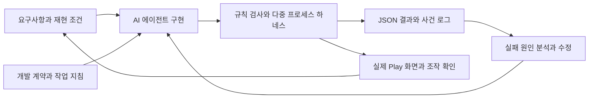
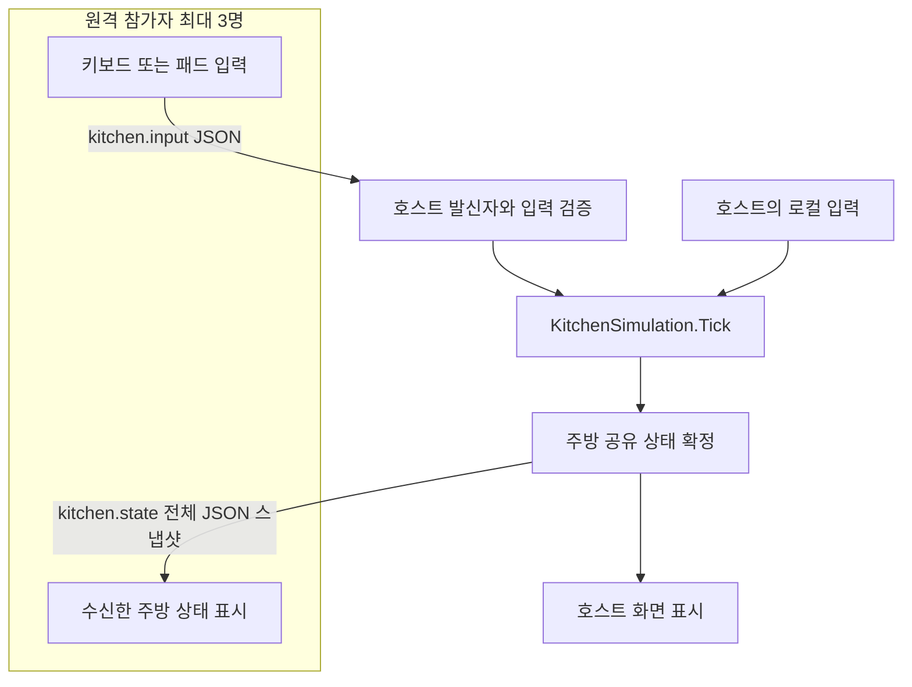

<div align="center">

# 🍳 CookedOver

**하네스 엔지니어링으로 AI 에이전트와 개발한 멀티플레이 협동 요리 게임**

AI 개발 규칙 · 자동 회귀 검사 · 호스트 권한 통신을 연결한 Unity 네트워크 학습 프로젝트


[AI 에이전트와 하네스](#-ai-에이전트와-하네스-엔지니어링) · [네트워크 통신](#-멀티플레이와-네트워크-통신) · [실행 방법](#-실행-방법) · [검증](#-검증)

</div>

---

## 📌 프로젝트 소개

CookedOver는 재료 손질·조리·서빙·설거지를 여러 플레이어가 함께 수행하는 Unity 협동 요리 게임입니다. 게임 내 이름은 **LITTLE LADLE**이며, Overcooked에서 영감을 받은 개인 학습용 프로토타입입니다.

이 프로젝트의 중심은 **하네스 엔지니어링을 통한 AI 에이전트 활용**과 **멀티플레이를 통한 네트워크 통신 학습**입니다. Codex가 구현과 검사 도구 작성을 지원하고, 개발자는 요구사항·플레이 방향·수정 조건을 정했습니다. 생성된 구현은 실제 플레이와 규칙 검사, 별도 프로세스 사이의 통신 검사로 확인하며 반복 수정했습니다.

단순히 접속되는 게임을 만드는 데서 나아가, **누가 게임 결과를 확정하는지, 입력을 어떻게 전달하는지, 모든 참가자가 같은 상태를 받는지, 연결이 끊기면 무엇을 정리하는지**를 코드와 실행 결과로 학습했습니다.

## ✨ 주요 기능

| 영역 | 구현 내용 |
| --- | --- |
| 🍅 두 개의 챕터 | Classic 수프 키친 · Burgers 버거 하우스 |
| 🔪 협동 조리 | 재료 집기·손질·굽기·끓이기·조립·서빙·설거지·소화 |
| 🎮 플레이 방식 | 1인 · 로컬 2인 · 호스트 포함 최대 4인 네트워크 플레이 |
| 📡 접속 | LAN 직접 연결 · Unity Relay 참가 코드 연결 |
| ❤️ 로그라이크 | 팀 체력, 주문 실패 피해, 사망 후 버튼으로 수동 재시작 |
| 🃏 성장 | 레벨 1 시작 · 서빙 경험치 · 기술 카드 10종 · 시너지 5종 · 진화 3종 |
| 👑 주방 변수 | 기름 바닥·부분 정전·주문 폭주 · 보스 주문과 설비 보상 |
| 🍔 키오스크 모드 | WPF 키오스크의 외부 주문 수신·부분 완료·서빙 결과 전송 경로 |
| 🧪 자동 검증 | 게임 규칙·직렬화 계약 · 4인 통신·정원 초과·퇴장·재접속 검사 |

### 모드별 규칙

| 구분 | 일반 로그라이크 | 키오스크 연동 |
| --- | --- | --- |
| 시간 | 전체 시간 UI는 숨김 · 내부 240초 웨이브와 개별 주문·보스 기한 유지 | 4분 영업 후 결과 화면 |
| 성장 | 팀 공용 기술·시너지·진화·설비 | 성장·이벤트·보스·설비 보상 제외 |
| 종료 | 팀 체력 소진 후 재시작 버튼 대기 | 게임 종료로 외부 미완료 주문을 완료·취소하지 않음 |
| 보스전 | 일반 주문 시간과 신규 유입 정지 · 보스 자체 시간은 진행 | 보스 없음 |

## 🤖 AI 에이전트와 하네스 엔지니어링

이 프로젝트에서 하네스는 **AI가 수정할 때 지켜야 할 계약, 실행 도구, 관측 지점, 검사와 결과 기록을 연결한 개발 환경**입니다. 한 번의 코드 생성으로 완료를 판단하지 않고, 기능을 바꿀 때 기존 규칙과 실제 통신이 유지되는지 확인하도록 구성했습니다.



### 사람과 AI의 역할

| 주체 | 담당한 일 |
| --- | --- |
| 개발자 | 게임 방향·기능 우선순위 결정, 플레이 피드백, 문제 재현 조건과 수정 기준 제시 |
| AI 에이전트 | C# 구현·수정, 하네스와 검사 코드 작성, 실행·결과 분석 지원 |
| 자동 하네스 | 실제 게임 코드의 규칙, 참가자 입력 처리, 수신 상태와 실패 조건 확인 |
| 실제 플레이 | 카드 효과의 체감, HUD·그래픽, 조작과 보스전의 플레이 흐름 확인 |

### 개발 계약을 실행 가능한 조건으로 연결

개발 환경에서는 `AGENTS.md`로 공통 계약을, 프로젝트 `SKILL.md`로 작업 위치와 세부 검증 절차를 관리했습니다. **이 두 파일과 별도 설명 문서는 업로드 범위에서 제외했으며**, 이 README에 핵심 원칙을 요약합니다.

- **권한:** 조리·점수·주문·보상은 호스트에서 판정합니다.
- **격리:** 하네스는 `--kitchen-harness`로만 켜지고, 실제 Relay·키오스크 서버·계정을 사용하지 않습니다.
- **변경별 검사:** 규칙 변경은 규칙 검사를, 통신 변경은 다중 프로세스 검사까지 수행합니다.
- **상태 계약:** 네트워크 필드를 추가하면 실제 수신 경로의 직렬화 왕복을 확인합니다.
- **완료 기준:** 실패·누락·타임아웃을 성공으로 취급하지 않고, 수행하지 않은 검사는 구분합니다.
- **빌드 일치:** 검증용 빌드 중 소스를 수정하지 않고, 현재 소스와 일치하는 실행 파일만 재사용합니다.

### 오래된 빌드와 과거 성공 기록을 구분

| 장치 | 역할 |
| --- | --- |
| 소스 SHA-256 | `Assets`·`Packages`·`ProjectSettings`를 해시로 비교해 오래된 빌드 재사용 방지 |
| 실행별 고유 폴더 | 이전 실행의 성공 보고서가 현재 결과에 섞이지 않게 분리 |
| 역할별 결과·종료 코드 | 일부 참가자가 멈추거나 보고서를 누락하면 실패 |
| 단계·전체 제한시간 | 무한 대기 대신 멈춘 단계와 로그를 남김 |
| 구조화된 보고서 | `summary.json`·`junit.xml`·역할별 JSON·사건 로그로 결과 추적 |

핵심 코드는 [PowerShell 러너](Harness/Run-Harness.ps1), [에디터 검사 진입점](Assets/CookedOver/Editor/Harness/KitchenHarnessEditor.cs), [런타임 하네스](Assets/CookedOver/Scripts/Harness)에 있습니다.

## 📡 멀티플레이와 네트워크 통신

### 호스트 권한 구조

한 플레이어가 서버 역할을 겸하는 **호스트 방식**입니다. 호스트가 `KitchenSimulation.Tick`으로 이동·조리·주문·점수·체력을 확정하고, 참가자는 자신의 입력을 보낸 뒤 호스트가 보낸 상태를 표시합니다.



조리대에서 재료를 가져가거나 같은 주문에 서빙하는 동작은 공유 자원을 바꿉니다. 참가자마다 결과를 확정하지 않고 호스트에 판정을 모아, 소지품·접시·주문 수량의 기준 상태를 하나로 유지합니다.

### 입력과 결과를 분리한 메시지

게임 데이터는 NGO의 `CustomMessagingManager`에 등록한 두 메시지로 교환합니다. 연결과 전송은 Netcode for GameObjects와 Unity Transport가 담당합니다.

| 메시지 | 방향 | 내용 |
| --- | --- | --- |
| `kitchen.input` | 참가자 → 호스트 | 이동 `x`·`y`, `interact`·`work`·`dash`·`toss` |
| `kitchen.state` | 호스트 → 참가자 | 셰프·음식·조리대·주문·점수·체력·성장·게임 모드 |

참가자는 “점수가 올랐다”는 결과 대신 “상호작용을 눌렀다”는 입력을 보냅니다. 실제 서빙 위치·소지 음식·주문 일치 여부는 호스트가 판단합니다.

### 발신자와 입력 검증

- 입력 패킷에는 조작할 셰프 ID를 넣지 않습니다. 연결의 `sender`를 호스트의 `slots` 매핑에서 조회해 배정된 셰프만 조작합니다.
- `NaN`·`Infinity` 이동값을 거부하고, 이동 벡터 크기를 1 이하로 제한합니다.
- 일회성 행동 입력은 호스트가 처리할 때까지 OR로 유지한 뒤 Tick 이후 지웁니다. 여러 클릭 횟수를 보존하는 이벤트 큐는 아닙니다.
- 호스트는 참가자가 보낸 상태 스냅샷을 적용하지 않습니다. 참가자도 서버 ID가 보낸 상태만 수신합니다.

### 시뮬레이션과 전송 주기

| 항목 | 코드의 설정 | 의미 |
| --- | --- | --- |
| 호스트 시뮬레이션 | `Update`의 `Time.deltaTime` | 호스트 프레임에 따라 게임 진행 |
| 일반 입력 | 약 30ms 간격 | 이동·작업 입력을 약 33회/초 조건으로 전송 |
| 단발 행동 | 상호작용·대시·던지기 발생 시 | 정기 입력 시점을 기다리지 않고 전송 |
| 전체 상태 | 약 75ms 간격 | 참가자마다 약 13회/초 조건으로 스냅샷 전송 |
| 입력 만료 | 마지막 입력 이후 0.4초 | 입력이 멈춘 원격 셰프의 조작 초기화 |

위 수치는 **설정값**이며 실제 처리율·왕복 지연 측정값이 아닙니다. 프레임과 부하에 따라 전송 시점이 달라집니다. 현재 게임 코드는 고정 네트워크 틱의 lockstep이나 클라이언트 예측·서버 보정·스냅샷 보간을 구현하지 않습니다.

공통 전송 메서드는 `ReliableFragmentedSequenced`를 사용합니다. 입력과 전체 상태에 신뢰·순서·분할 전송을 적용한 단순한 구성에서 출발했으며, 손실 시 재전송과 순서 대기로 최신 상태 도착이 늦어질 수 있습니다. 향후 이동과 단발 행동의 전달 방식을 분리하고 전송량·지연을 측정할 과제로 남겼습니다.

### 접속 종료와 재접속

| 상황 | 처리 |
| --- | --- |
| 정원 초과 | 호스트 포함 4명 제한 · 거절 사유 전송 |
| 참가자 접속 | 빈 셰프 자리 배정 · 활성화 · 스폰 위치 설정 |
| 입력 중단 | 0.4초가 지나면 입력 초기화 · 연결 종료 자체와 구분 |
| 참가자 퇴장 | 소지품을 바닥에 드롭 · 자리·입력·연결 매핑 정리 |
| 재접속 | 새 연결로 빈 자리를 배정받고 현재 주방 스냅샷 수신 |
| 호스트 종료 | 참가자는 연결을 해제하고 메뉴로 복귀 |

재접속은 **현재 공유 상태를 다시 받는 기능**입니다. 계정 기반으로 이전 셰프 자리와 소지품을 되돌리는 영구 세션 복구, 호스트 마이그레이션은 제공하지 않습니다.

### LAN과 Relay의 책임 구분

LAN은 호스트 IP와 UDP 7777 포트로 연결합니다. Relay는 Unity Services 초기화·익명 인증·참가 코드·DTLS 설정으로 연결 경로를 준비합니다. 두 경로 모두 연결 후에는 같은 게임 메시지를 사용합니다.

Relay가 게임 판정을 대신하지는 않습니다. Relay를 사용해도 플레이어 호스트가 상태를 확정합니다. 자동 하네스는 서비스 연결 대신 전용 loopback 포트에서 같은 메시지 경로를 검사합니다.

구현: [KitchenGame.cs](Assets/CookedOver/Scripts/KitchenGame.cs) · [KitchenSimulation.cs](Assets/CookedOver/Scripts/KitchenSimulation.cs)

## 💡 문제 해결 사례

| 문제 | 수정과 확인 |
| --- | --- |
| 자동 설거지 설비 선택 후 접시 증가 | 접시 생성 효과 제거 · 기존 더러운 접시의 상태만 전환 · 실제 꺼내기·서빙·세척 20회에서 전체 4개 보존 검사 |
| 보스 주문 처리 중 일반 주문 만료로 이중 불이익 | 일반 주문 시간·신규 유입만 정지 · 보스 시간과 조리는 유지 · 실패 프레임의 중복 피해 검사 |
| 보스가 없는 상태의 JSON 복원 | `bossActive`로 존재 여부를 명시 · `FromSnapshot`에서 비활성 객체를 null로 정규화 · 실제 수신 경로 검사 |
| 입력이 끊겨도 마지막 방향으로 이동 | 마지막 수신 시각 관리 · 0.4초 이후 입력 초기화 · 참가자 패킷 전송 중단으로 검사 |

접시 총수는 깨끗한 접시·설거지 대기·셰프 소지품·조리대·바닥·접시를 사용하는 요리를 합산합니다. 음료는 접시로 계산하지 않습니다.

## 🧰 기술 구성

| 구분 | 기술과 용도 |
| --- | --- |
| 엔진 | Unity `6000.3.26f1` · Universal Render Pipeline |
| 언어 | C# |
| 입력 | Unity Input System · 키보드·게임패드 |
| 통신 | Netcode for GameObjects `2.13.3` · Unity Transport |
| 온라인 연결 | Unity Services · 익명 인증 · Relay |
| 데이터 | `InputPacket`·`KitchenState` · JsonUtility · JSON 스냅샷 |
| AI 개발 | Codex · 공통 계약과 프로젝트 작업 지침 |
| 하네스 | PowerShell 7 · Unity CLI · 헤드리스 다중 프로세스 |
| 결과 기록 | JSON · JSONL · JUnit XML · Unity 로그 |

의존성은 [manifest.json](Packages/manifest.json)과 [packages-lock.json](Packages/packages-lock.json), 에디터 버전은 [ProjectVersion.txt](ProjectSettings/ProjectVersion.txt)에서 확인할 수 있습니다.

## 🚀 실행 방법

### 준비 환경

- Unity Hub 및 Unity `6000.3.26f1`
- 하네스 실행 시 Windows, PowerShell 7, `unity` CLI와 현재 에디터의 연결 구성
- Relay 사용 시 본인 Unity 프로젝트의 Services 연결·서비스 활성화
- 키오스크 사용 시 별도 주문 서버와 기기 계정 구성

### 1. 프로젝트 열기

```powershell
git clone https://github.com/baeseojin/CookedOver.git
cd CookedOver
```

Unity Hub에서 복제한 폴더를 추가하고 패키지 가져오기가 끝나면 `Assets/Scenes/KitchenStage.unity`를 열어 Play를 누릅니다. 씬을 다시 생성하려면 `CookedOver > Create Kitchen Stage` 메뉴를 사용합니다. 기존 작업 씬은 먼저 저장합니다.

### 2. 플레이 방식 선택

- **혼자 요리하기:** 1인 플레이
- **둘이서 요리하기:** 같은 PC에서 키보드 2인 또는 게임패드
- **같은 네트워크:** 호스트가 방을 만들고, 참가자는 호스트의 LAN IP로 접속
- **온라인 코드:** 호스트가 Relay 방을 만들고 참가 코드를 공유

원격 PC 참가자는 `127.0.0.1` 대신 실제 호스트 주소를 사용해야 합니다. LAN 접속은 UDP 7777에 대한 방화벽·네트워크 접근 설정이 필요할 수 있습니다. 인터넷 코드는 별도 Unity Services 설정이 필요합니다.

### 3. 조작

| 동작 | 1P 및 온라인 참가자 | 로컬 2P | 게임패드 |
| --- | --- | --- | --- |
| 이동 | WASD | 방향키 | 왼쪽 스틱 |
| 집기·놓기·상호작용 | E | Enter | 남쪽 버튼 |
| 손질·설거지·소화 | F 누르기 | 오른쪽 Shift | 서쪽 버튼 |
| 대시 | Space | 오른쪽 Ctrl | 동쪽 버튼 |
| 던지기 | Q | 역슬래시 | 북쪽 버튼 |
| 일시정지 | Esc · 오프라인 | 공유 | 키보드 Esc |

## 📁 프로젝트 구조

```text
CookedOver/
├── Assets/
│   ├── Scenes/KitchenStage.unity          # 시작 씬
│   └── CookedOver/
│       ├── Scripts/
│       │   ├── KitchenGame*.cs            # 접속 · 입력 · 메뉴와 HUD
│       │   ├── KitchenSimulation*.cs      # 호스트 조리 · 주문 · 성장 규칙
│       │   ├── KitchenView*.cs            # 주방 · 셰프 · 재료 렌더링
│       │   ├── KitchenKioskBridge.cs      # 외부 주문 통신 경로
│       │   └── Harness/                   # 명시적 인자로 활성화하는 통신 검사
│       └── Editor/
│           ├── KitchenStageBuilder.cs    # 씬 생성
│           └── Harness/                   # 규칙 · 상태 계약 · 빌드 진입점
├── Harness/
│   ├── Run-Harness.ps1                    # 전체 검사 실행
│   └── report.schema.json                # 보고서 형식
├── Packages/                             # 의존성 목록과 잠금 파일
└── ProjectSettings/                      # 에디터 버전과 프로젝트 설정
```

## 🧪 검증

### 실행

현재 프로젝트를 Unity 에디터에 열고 가져오기·컴파일이 끝난 상태에서 실행합니다. 검증용 Player 빌드 전에는 Play 모드를 종료합니다. `unity status --json`에서 대상 프로젝트와 에디터 포트를 확인합니다.

```powershell
# 게임 규칙과 스냅샷 계약 검사
pwsh -NoProfile -File Harness/Run-Harness.ps1 -RulesOnly

# 규칙 → 현재 소스 빌드 또는 재사용 → Classic → Burgers
pwsh -NoProfile -File Harness/Run-Harness.ps1

# 버거 챕터만 실행
pwsh -NoProfile -File Harness/Run-Harness.ps1 -Chapter Burgers

# 에디터 포트가 기본 7800과 다른 경우 실제 포트로 변경
pwsh -NoProfile -File Harness/Run-Harness.ps1 -EditorPort 7800
```

`-SkipBuild`는 소스 해시와 일치하는 빌드에만 사용할 수 있습니다. 프로젝트 경로 이동 후 빌드 캐시 문제가 발생하면 `-CleanBuild`로 Player 빌드 캐시를 다시 만들 수 있습니다. 두 옵션은 함께 사용하지 않습니다.

에디터 메뉴 `CookedOver > Harness > Verify Rules and Contracts`에서도 규칙 검사를 실행할 수 있습니다. `unity` CLI는 별도 도구이며 Unity 에디터 설치만으로 자동 구성되는 것은 아닙니다.

### 다중 프로세스로 확인하는 내용

각 챕터에서 **호스트 1개 + 참가자 3개 + 정원 초과 검사 참가자 1개**를 실행합니다. Classic과 Burgers는 순차 실행합니다.

| 검사 영역 | 대표 확인 조건 |
| --- | --- |
| 권한 | 위조 상태 거부 · 연결 ID에 따른 조작 대상 제한 |
| 입력 | 실제 이동·집기·서빙 메시지 처리 · 입력 전송 중단 후 이동 정지 |
| 주문 | 점수·접시 반영 · 단체 주문 부분 완료 · 보스 보상 |
| 상태 | 진화·설비·주문 상태의 참가자 스냅샷 수신 |
| 보스전 | 일반 주문 5초와 다음 유입 1초 유지 · 보스 시간만 감소 |
| 연결 | 정원 초과 사유 · 퇴장 소지품 드롭 · 재접속 후 현재 상태 복원 |
| 종료 | 사망 후 수동 재시작 · 호스트 종료 후 참가자 메뉴 복귀 |

검사는 경계조건을 만들기 위해 호스트의 위치·소지품·주문을 준비합니다. **검증할 행동은 참가자 프로세스에서 실제 메시지로 전송하고, 참가자는 실제 수신한 상태를 확인합니다.** `control-NNNN.json`은 검사 단계와 대상 ID를 공유할 뿐, 게임 결과를 참가자에게 전달하지 않습니다.

### 보존된 검증 기록 — 2026-11-01

| 항목 | 결과 |
| --- | --- |
| 전체 하네스 | `passed` |
| 실행 범위 | `rulesOnly: false` · Classic 및 Burgers |
| 검사 항목 합계 | 144개 |
| 구조화 보고서 | 규칙 1개 + 챕터별 역할 5개씩 총 11개 |
| 실행 ID | `20261101T074005760Z-903a29f1` |

144개는 역할별 반복을 포함한 **검사 항목 합계**이며 서로 독립적인 시나리오 144개를 뜻하지 않습니다. 이번 README 작성으로 게임을 재실행한 결과가 아니라, 개발 중 보존한 실행 기록입니다. 원본 보고서·사건 로그·스크린샷은 로컬 산출물로 이 저장소에 업로드하지 않았습니다.

재실행 결과는 `HarnessResults/latest.json`이 가리키는 실행 폴더의 `summary.json`, `junit.xml`, 역할별 보고서·Unity 로그에서 확인합니다. 규칙 검사만 통과한 결과를 네트워크 검사 완료로 취급하지 않습니다.

## 📍 현재 범위와 후속 학습

- **로컬 통신과 인터넷 품질:** 하네스는 loopback의 실제 프로세스 간 메시지를 검사합니다. 서로 다른 PC·Relay의 지연·손실·장시간 부하는 별도 검증 대상입니다.
- **호스트 신뢰:** 플레이어 호스트가 판정하는 구조입니다. 전용 서버·호스트 이전·경쟁 게임 수준의 부정행위 방지는 구현하지 않았습니다.
- **반응성과 전송량:** 전체 JSON 상태를 전송합니다. RTT·스냅샷 크기·초당 전송량을 측정하고 보간·예측·메시지별 전달 방식 분리를 학습할 계획입니다.
- **외부 주문:** 키오스크 통신 코드는 포함하지만 WPF 앱과 서버는 별도입니다. 하네스는 메모리 콜백으로 검사하며 실제 주문 서버나 결제 데이터를 사용하지 않습니다.
- **시각 검수:** 헤드리스 검사로 그래픽·조작감을 판정하지 않습니다. 실제 Play 화면을 별도로 확인했습니다.

## 📦 저장소 관리

Unity 소스·씬·재질과 `.meta`, 패키지·프로젝트 설정, 하네스 실행·검사 코드를 관리합니다. `Library/`, `Temp/`, `Builds/`, `HarnessResults/`, 개인 IDE 설정과 로컬 비밀정보는 제외합니다.

별도 설명 문서, AI 작업 지침 원문과 Word 포트폴리오는 업로드하지 않으며 **프로젝트 소개는 이 README에 모았습니다.**

---

<div align="center">

**CookedOver · AI 에이전트 하네스와 호스트 권한 네트워크 통신을 학습한 Unity 프로젝트**

</div>
